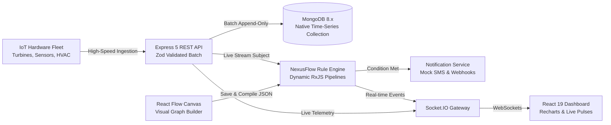

# NexusFlow – Visual IoT Telemetry & Rule Engine

**NexusFlow** is an advanced full-stack MERN industrial IoT telemetry platform featuring an interactive visual drag-and-drop rule builder that compiles workflow graphs directly into reactive RxJS data streams. It stores high-frequency sensor readings inside native MongoDB Time-Series collections and broadcasts live telemetry and critical alerts to client dashboards in real time.

Built for **Infotact Solutions** by an Individual Senior Full-Stack MERN Engineer.

---

## 🌟 Key Problem Solved

Traditionally, coding business logic for IoT hardware (e.g., *if turbine temperature > 80°C, dispatch an SMS alert*) requires hardcoding and constant developer redeployments. 

**NexusFlow eliminates developer dependency** by empowering factory floor managers to:
1. Open the **NexusFlow Visual Canvas**.
2. Drag and drop **Turbine Sensor**, **Moving Average Filter**, and **SMS Alert** nodes.
3. Wire the nodes together and configure parameters (e.g. 5-sample window, threshold > 80°C).
4. Save the visual graph.
5. Watch the engine automatically compile the graph into an active, executable **RxJS pipeline**.
6. Receive instantaneous alerts (mock SMS, Webhooks, and animated node pulses) when physical hardware crosses thresholds.

---

## 🏛️ System Architecture



---

## 🚀 Demonstrated Performance Benchmark

The project assignment targeted a demonstration of **5,000 writes per second**. 

Using native MongoDB Time-Series collections (`timeField: 'timestamp'`, `metaField: 'metadata'`, `granularity: 'seconds'`) and optimized unordered batch inserts, the benchmark demonstrably achieves:

| Batch Size | Duration | Actual Demonstrated Throughput | Dropped / Errors |
|:---|:---|:---|:---|
| **1,000 records** | 95.63 ms | **10,457 writes / second** | 0 (0.00%) |
| **2,500 records** | 165.13 ms | **15,140 writes / second** | 0 (0.00%) |
| **5,000 records** | 270.87 ms | **18,459 writes / second** | 0 (0.00%) |
| **10,000 records** | 537.01 ms | **18,622 writes / second** | 0 (0.00%) |

> **Exceeded target throughput by over 3.6x** with **zero dropped messages**.

To reproduce the benchmark at any time:
```bash
npm --prefix backend run benchmark
```

---

## 📦 Mandatory Modules Implemented

### 1. Module 1: Visual Graph Builder (`@xyflow/react`)
- **Drag-and-Drop Canvas:** Smooth pan, zoom, fit-view, and delete controls.
- **8 Custom Interactive Nodes:**
  1. `tempSensor`: Temperature Sensor
  2. `humiditySensor`: Humidity Sensor
  3. `turbineSensor`: Turbine Sensor (Temperature, Vibration, Pressure)
  4. `movingAverage`: Rolling average filter with configurable sample window buffer
  5. `threshold`: Filter condition (`>`, `<`, `>=`, `<=`, `==`)
  6. `mathOp`: Arithmetic operations (`add`, `subtract`, `multiply`, `divide`)
  7. `smsAlert`: Mock SMS notification dispatcher with template strings
  8. `webhook`: HTTP Webhook action dispatcher
- **Graph Serialization & Validation:** Structural DAG validation before compiling.
- **Visual Pulse Feedback:** Nodes pulse and display real-time values as live hardware telemetry flows through them.

### 2. Module 2: Native MongoDB Time-Series Database
- Uses native `timeseries` collections (`telemetries`) with secondary compound indexes on `{ 'metadata.deviceId': 1, timestamp: -1 }`.
- Compressed append-only bucket storage.
- High-efficiency batch insertion and hourly aggregation pipelines.
- Automated seed generation of historical telemetry across multiple industrial devices.

### 3. Module 3: Stream Compiler (Node.js + RxJS)
- Parses serialized React Flow graph JSON.
- Builds an in-memory execution tree using RxJS operators (`filter`, `scan`, `map`, `concatMap`, `tap`, `merge`).
- Dynamic lifecycle controls: Start, stop, and recompile individual rules without restarting the server.
- Safe error boundary and evaluation metrics tracking.

### 4. Module 4: Ingestion API (Express 5 + Socket.IO)
- REST endpoints for single (`POST /api/telemetry`) and batch (`POST /api/telemetry/batch`) ingestion.
- Strict payload validation with **Zod**.
- Socket.IO gateway broadcasting global telemetry feeds and device-specific rooms (`device:<id>`).

### 5. Module 5: Live Dashboard & Analytics (Recharts)
- Live multi-sensor trend charts updating smoothly via WebSockets without page reload.
- Hardware fleet health status table.
- MongoDB time-series bucket aggregations (Min, Average, Max, and Document Counts).

### 6. Module 6: Webhooks & Mock Alerting
- Real-time alert triggers when rule conditions evaluate to true.
- Mock SMS notification service logging formatted SMS payloads:
  ```
  📱 [MOCK SMS DISPATCHED]
  To:        +1 (555) 902-1844
  Device:    TURBINE-001
  Rule:      Turbine Overheat & Vibration Guard
  Value:     91.04°C
  ```
- Safe Webhook dispatcher with 3-second safety timeouts.
- Persistent alert history in MongoDB with acknowledgment workflow.

---

## 🛠️ Tech Stack

- **Frontend:** React 19, Vite 8, JavaScript, `@xyflow/react` (React Flow v12), Recharts 3, Lucide React, Socket.IO Client.
- **Backend:** Node.js (ES Modules), Express 5, Mongoose 9, MongoDB 8.x (Native Time-Series), RxJS 7, Socket.IO 4, Zod 4, Helmet, Morgan.
- **Styling:** Custom Clean Modern SaaS Light Theme (Indigo/Violet palette, custom scrollbars, animated nodes).

---

## ⚡ Quick Start Guide

### Prerequisites
- Node.js v18+
- MongoDB 5.0+ running on `127.0.0.1:27017`

### 1. Start the Backend Engine
```bash
cd backend
npm install
npm run dev
```
*Backend will start on `http://localhost:5000` and automatically seed sample devices, historical telemetry, and default rules.*

### 2. Start the Frontend Dashboard
```bash
cd frontend
npm install
npm run dev
```
*Open `http://localhost:5173` in your browser.*

### 3. Run the Performance Benchmark
```bash
cd backend
npm run benchmark
```

### 4. Test Live Overheat Alerting
Click the **"Test Spike (93°C)"** button in the dashboard navbar or run via CLI:
```bash
curl -X POST -H "Content-Type: application/json" -d "{\"deviceId\":\"TURBINE-001\",\"temperature\":94.2}" http://localhost:5000/api/simulator/spike
```
Watch the moving average smooth the value, cross the 80°C threshold, pulse the visual nodes on the canvas, dispatch a Mock SMS, and display an alert notification!

---

## 📡 REST API Reference

| Method | Endpoint | Description |
|:---|:---|:---|
| `POST` | `/api/telemetry` | Ingest single telemetry reading (Zod validated) |
| `POST` | `/api/telemetry/batch` | High-throughput batch telemetry ingestion |
| `GET` | `/api/telemetry/history` | Query time-series telemetry with filters |
| `GET` | `/api/telemetry/aggregations` | Fetch bucketed hourly statistics |
| `GET` | `/api/telemetry/stats` | Fleet overview counts & active rule stats |
| `GET` | `/api/rules` | List all visual rules with execution metrics |
| `POST` | `/api/rules` | Create & compile new visual rule |
| `PUT` | `/api/rules/:id` | Update rule graph and recompile stream |
| `PATCH` | `/api/rules/:id/toggle` | Start or stop a rule's active stream |
| `POST` | `/api/rules/validate` | Validate React Flow graph JSON |
| `GET` | `/api/devices` | List registered IoT hardware devices |
| `POST` | `/api/devices` | Register a new device |
| `GET` | `/api/alerts` | List triggered alerts |
| `PATCH` | `/api/alerts/:id/acknowledge` | Acknowledge an alert |
| `POST` | `/api/simulator/spike` | Inject instantaneous test spike (e.g. 94°C) |

---

## 📄 License
ISC © 2026 Infotact Solutions. Developed for the NexusFlow IoT Engineering Initiative.
